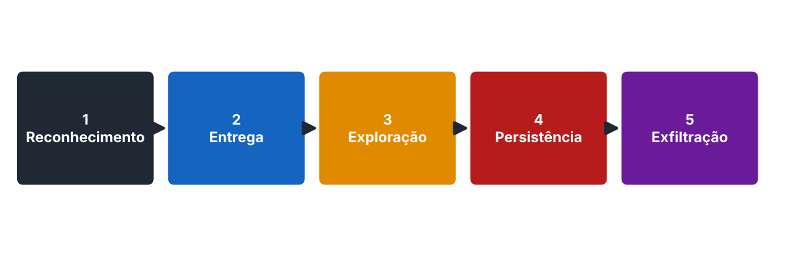

# Cadeia de ataque

Um ataque raramente acontece de uma vez. Ele avança por etapas, e cada etapa é uma chance de a defesa interromper o atacante.

| Fase | O que acontece | Exemplo |
|---|---|---|
| **1. Reconhecimento** | O atacante mapeia o alvo: e-mails, IPs, serviços expostos | Consultar WHOIS, buscar funcionários em redes sociais |
| **2. Entrega** | O ataque chega até a vítima | E-mail de phishing, pen drive, site com exploit |
| **3. Exploração** | Uma vulnerabilidade é explorada e o código malicioso roda | Macro que executa ao abrir um anexo |
| **4. Persistência** | O acesso é mantido mesmo após reiniciar o sistema | Chave de registro que reinicia o malware no boot |
| **5. Exfiltração** | Dados ou controle saem do ambiente | Envio de arquivos para servidor externo |

## Complemento: Cyber Kill Chain de 7 fases

Reconhecimento, Armamento, Entrega, Exploração, Instalação, Comando e Controle (C2) e Ações sobre os Objetivos. Detalha as mesmas etapas com mais granularidade.

## Perguntas de revisão

1. Em qual fase o atacante mantém acesso mesmo após o sistema reiniciar?

Resposta

Persistência.

