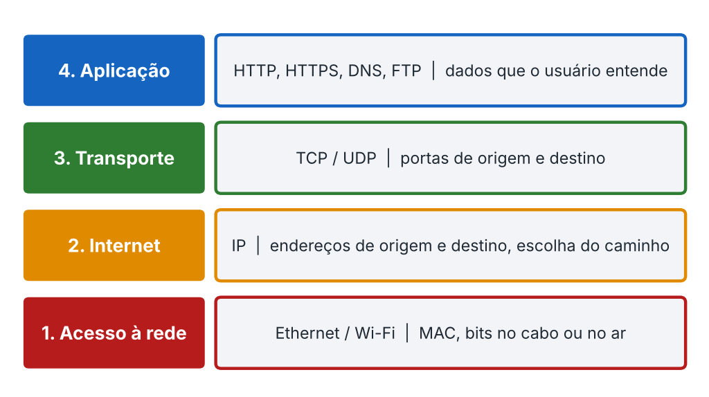
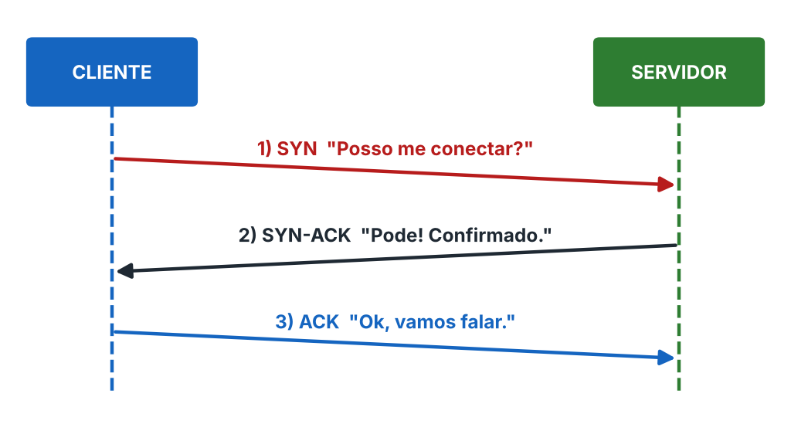
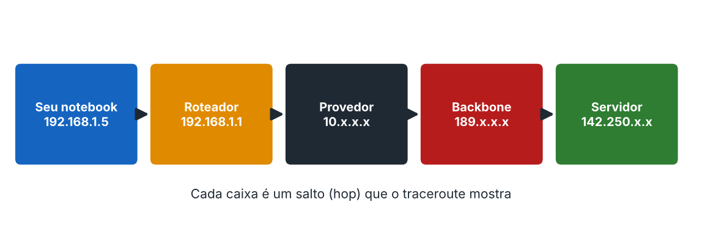

# Camadas TCP/IP e handshake

## As 4 camadas

| Camada | O que faz | Exemplo |
|---|---|---|
| **4. Aplicação** | Dados que o usuário entende: HTTP, HTTPS, DNS, FTP | O navegador monta `GET /index.html` |
| **3. Transporte** | TCP ou UDP; segmenta e adiciona portas | TCP porta 443 |
| **2. Internet** | IP: escolhe o caminho | `192.168.1.5` → `142.250.x.x` |
| **1. Acesso à rede** | Ethernet/Wi-Fi; MAC; bits no meio físico | O pacote sai pela placa de rede |

### Encapsulamento

| Camada | Unidade de dados | O que é adicionado |
|---|---|---|
| Aplicação | Dados | A mensagem |
| Transporte | Segmento (TCP) / datagrama (UDP) | Portas e controle de sequência |
| Internet | Pacote | IPs e TTL |
| Acesso à rede | Quadro (frame) | MACs |

## Three-way handshake

| Passo | Flag | Quem envia | Significado |
|---|---|---|---|
| 1 | SYN | Cliente → servidor | "Posso me conectar?" |
| 2 | SYN-ACK | Servidor → cliente | "Pode! Confirmado." |
| 3 | ACK | Cliente → servidor | "Ok, vamos falar." |

Se o SYN-ACK nunca chegar, o cliente reenvia o SYN algumas vezes e desiste.

## Traceroute

Todo pacote IP tem um **TTL** que cada roteador reduz em 1. Quando chega a zero, o roteador descarta e devolve um aviso ICMP. O traceroute usa isso: envia com TTL 1, 2, 3... e revela cada salto. Linhas `* * *` indicam roteador que não respondeu (normalmente bloqueia ICMP).
