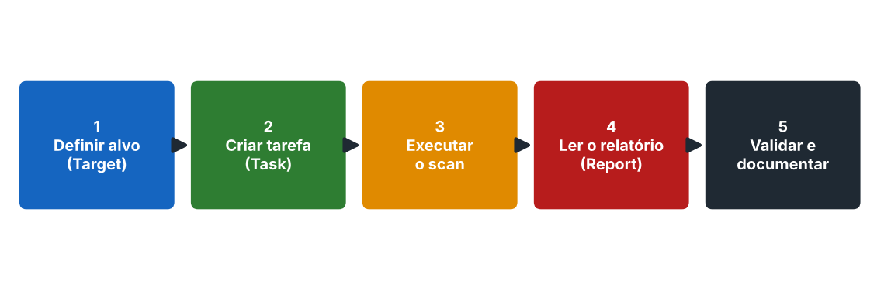

# Scan de vulnerabilidades com OpenVAS

> Pode **derrubar serviços frágeis** ou disparar alarmes. Use apenas em laboratório ou com autorização escrita.

Compara o que foi encontrado com um banco de falhas conhecidas e informa quais provavelmente existem, com nota e correção sugerida.

| | Scan de vulnerabilidades | Pentest |
|---|---|---|
| O que faz | Identifica falhas conhecidas automaticamente | Tenta explorar para provar o impacto |
| Quem executa | Ferramenta, com revisão humana | Profissional |
| Falso positivo | Existe | Menor |

## Componentes

| Componente | Função |
|---|---|
| Scanner (OpenVAS) | Executa os testes |
| Gerenciador (GVM) | Guarda alvos, tarefas e resultados |
| Interface web (Greenbone Security Assistant) | Normalmente `https://127.0.0.1:9392` |

## Instalação no Kali

```bash
sudo apt update
sudo apt install gvm -y
sudo gvm-setup          # demora; mostra a senha do admin uma única vez
sudo gvm-check-setup
sudo gvm-start
```

Nomes e interface podem variar por versão; consulte a documentação da Greenbone.

## Fluxo



| Etapa | Onde | O que fazer |
|---|---|---|
| 1. Alvo | Configuration > Targets | Nome e IP do alvo autorizado |
| 2. Tarefa | Scans > Tasks | Escolha o alvo e o perfil (*Full and fast*) |
| 3. Executar | Botão Play | Aguarde |
| 4. Relatório | Scans > Reports | Filtre por severidade |
| 5. Validar | Fora do OpenVAS | Confirme e tire prints |

## Lendo um resultado

| Campo | Como usar |
|---|---|
| Name (NVT) | Título do achado |
| Severity | Nota CVSS: define a prioridade |
| QoD | Confiança da detecção; abaixo de 70% pede confirmação |
| Host / Port | Host afetado |
| Summary / Insight | Descrição técnica |
| Detection Result | Evidência |
| Solution | Mitigação |
| References | CVEs |

**Falso positivo:** o scanner aponta um problema que não existe. Confirme os importantes com `nmap -sV`, consulta no NVD e novo teste.

## Análise manual (alternativa)

1. `nmap -p- -sV [IP]`
2. `nmap --script vuln [IP]`
3. Buscar CVEs no `nvd.nist.gov` e confirmar que a versão é afetada.
4. Registrar CVE, CVSS e descrição; classificar a severidade pelo impacto no negócio.

## Boas práticas

- Documente data, hora, alvo e configuração.
- Reavalie a severidade pelo contexto do negócio.
- Ordene do CVSS mais alto ao mais baixo.
- Reescaneie após a correção.
