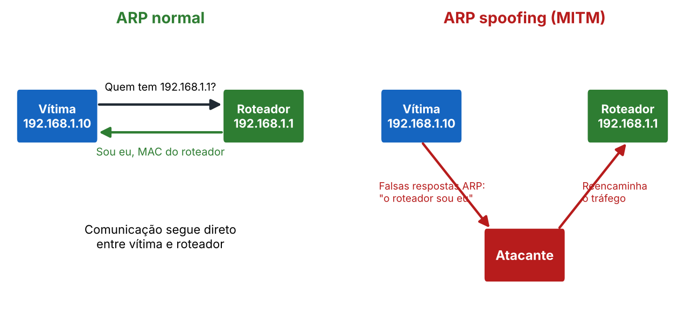

# Detecção de ARP spoofing

O **ARP** descobre qual MAC corresponde a um IP na rede local.



| | ARP normal | ARP spoofing |
|---|---|---|
| 1 | Computador pergunta: "Quem tem 192.168.1.1?" | Atacante responde: "Sou eu, para qualquer IP!" |
| 2 | Roteador responde com seu MAC | Todo o tráfego passa pelo atacante |
| 3 | Comunicação normal | Atacante vira intermediário (**MITM**) |

Quem se passa pelo **gateway** intercepta todo o tráfego que sai da rede.

## Passo a passo para analisar um `.pcap`

1. **File > Open**.
2. **Statistics > Protocol Hierarchy**: volume inesperado de ARP é alerta.
3. Filtro `arp` (ou `arp.opcode == 2` só para respostas).
4. **Statistics > Conversations > Ethernet**: identifique MAC e IP com mais pacotes.
5. Compare o volume com os demais e veja se o **mesmo MAC responde por vários IPs**.
6. Volte ao `tcp` para localizar o handshake, se a atividade pedir.
7. Tire prints com o filtro aplicado e anote o filtro exato.
8. Conclua: qual ataque o padrão indica, o que o atacante ganha, o que a defesa deve fazer.

## Exemplo ilustrativo: normal

```
No.  Source              Destination         Protocol  Info
1    00:11:22:33:44:55   Broadcast           ARP       Who has 192.168.1.1? Tell 192.168.1.10
2    aa:bb:cc:dd:ee:ff   00:11:22:33:44:55   ARP       192.168.1.1 is at aa:bb:cc:dd:ee:ff
```

Linha 1: pergunta para todos (broadcast). Linha 2: o roteador responde só ao solicitante.

## Exemplo ilustrativo: suspeito

```
No.  Source              Destination         Protocol  Info
10   de:ad:be:ef:00:01   00:11:22:33:44:55   ARP       192.168.1.1 is at de:ad:be:ef:00:01
11   de:ad:be:ef:00:01   00:11:22:33:44:66   ARP       192.168.1.1 is at de:ad:be:ef:00:01
12   de:ad:be:ef:00:01   00:11:22:33:44:77   ARP       192.168.1.20 is at de:ad:be:ef:00:01
13   de:ad:be:ef:00:01   00:11:22:33:44:88   ARP       192.168.1.30 is at de:ad:be:ef:00:01
```

O **mesmo MAC** afirma ser dono de vários IPs, inclusive do gateway, e envia respostas sem ninguém ter perguntado.

**Quem ganha o quê?** Posição de intermediário: pode ler, alterar ou descartar o tráfego das vítimas. É a base de ataques man-in-the-middle.
