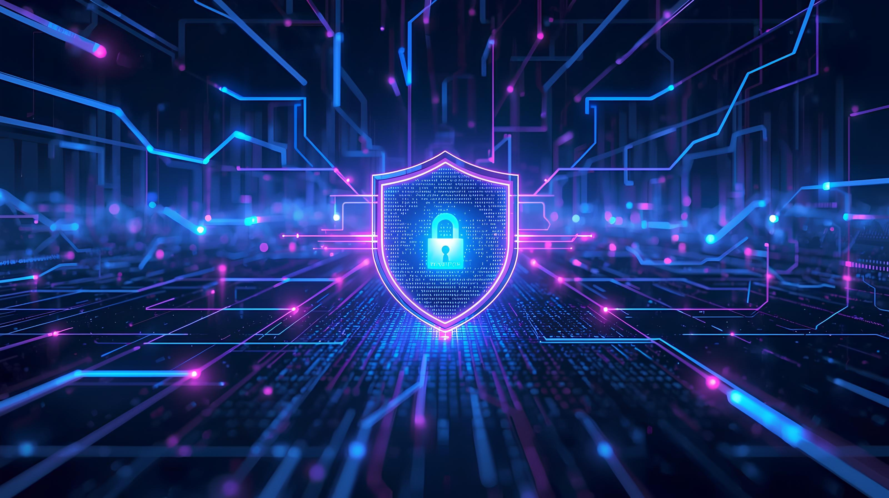

<div align="center">



# CYBERSEC NOTES

### `> Exploring the digital universe_`

**LEARN · ANALYZE · DEFEND · EVOLVE**


</div>

---

## `root@orbital:~$ whoami`

Sou **Thais Coelho**, estudante de Ciência da Computação e entusiasta de Cibersegurança.

O **CyberSec Notes** é minha base de conhecimento para documentar conceitos, ferramentas, comandos, análises e laboratórios práticos, com foco em segurança ofensiva **autorizada** e defesa.

```text
thais@orbital:~$ cat mission.txt
[+] Learn the fundamentals
[+] Practice in authorized environments
[+] Analyze evidence and document findings
[+] Improve defensive thinking
```

## `root@orbital:~$ ls modules/`

| ID | Módulo | Conteúdo |
|:--:|:--|:--|
| `01` | [Fundamentos](./01-Fundamentos/) | Modelo CIA, MITRE ATT&CK e incidentes |
| `02` | [Redes de Computadores](./02-Redes/) | TCP/IP, DNS, portas e protocolos |
| `03` | [Linux](./03-Linux/) | Terminal, permissões, serviços e logs |
| `04` | [OSINT](./04-OSINT/) | Reconhecimento e fontes abertas |
| `05` | [Pentest](./05-Pentest/) | Nmap, enumeração e análise de vulnerabilidades |
| `06` | [Blue Team](./06-Blue-Team/) | Wireshark, monitoramento e resposta |
| `07` | [Laboratórios](./07-Laboratorios/) | Ambientes controlados e relatórios |
| `08` | [Ferramentas](./08-Ferramentas/) | Glossário, comandos e referências |

## `root@orbital:~$ cat toolkit.md`

<div align="center">


</div>

## `root@orbital:~$ cat methodology.md`

1. **Fundamentos** — conceitos e contexto.
2. **Aplicação** — exemplos e comandos comentados.
3. **Laboratório** — prática em ambiente controlado.
4. **Evidências** — resultados e observações.
5. **Conclusão** — aprendizados e recomendações.
6. **Referências** — materiais de apoio.

<details>
<summary><strong>Como navegar e estudar</strong></summary>

- Comece por Fundamentos e Redes; avance para Linux, OSINT e Pentest.
- Use o índice de cada pasta para abrir os capítulos.
- Reproduza exercícios apenas em ambientes próprios ou autorizados.
- Registre dúvidas, resultados e referências em suas anotações.

</details>

## `root@orbital:~$ cat ethics.txt`

> **Uso ético e responsável:** este material tem finalidade educacional. Testes e varreduras devem ocorrer somente em ambientes próprios ou com autorização explícita. Não publique credenciais, dados pessoais ou detalhes sensíveis dos laboratórios.

## Créditos e referências

Parte das anotações foi desenvolvida a partir de estudos no curso **Cibersegurança 2.0 — Kodie Academy**, com organização e redação próprias. Materiais internos e credenciais não são reproduzidos aqui.

---

<div align="center">

### THAIS COELHO

**Computer Science Student · Cybersecurity Enthusiast**

<sub>CYBERSEC NOTES · LEARN / PRACTICE / DOCUMENT / EVOLVE</sub>

</div>
